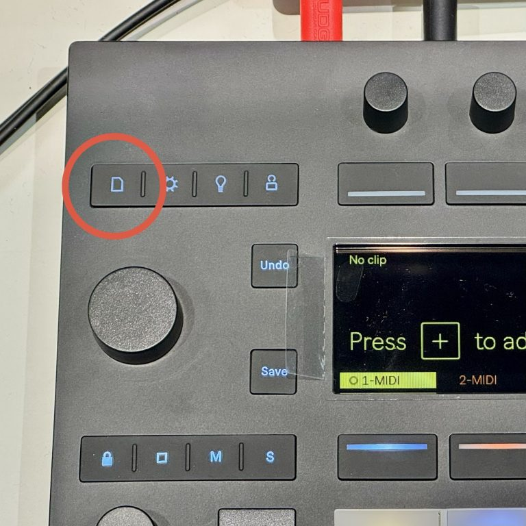
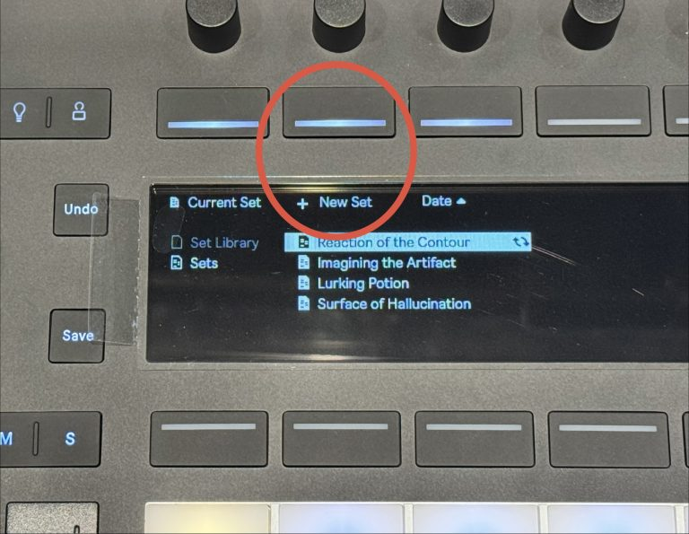
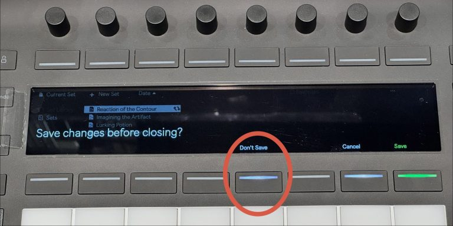
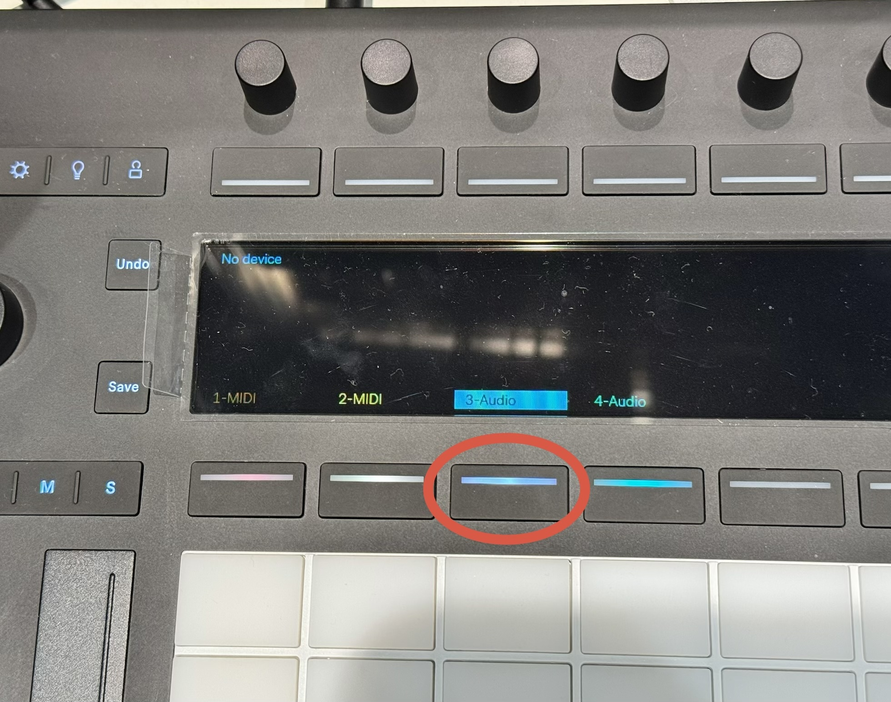
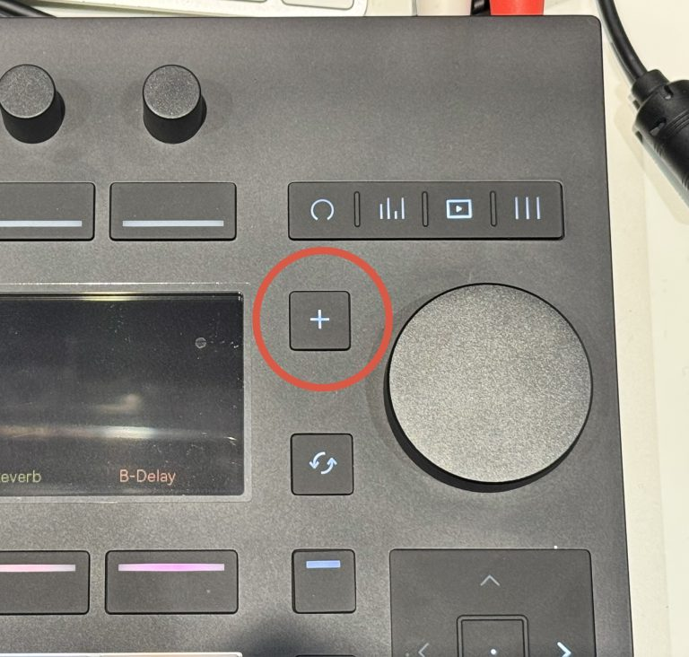
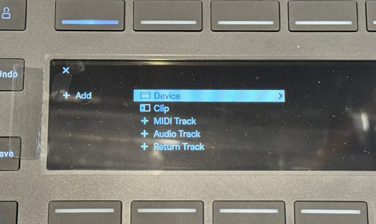
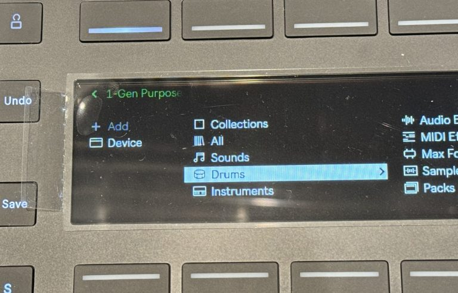
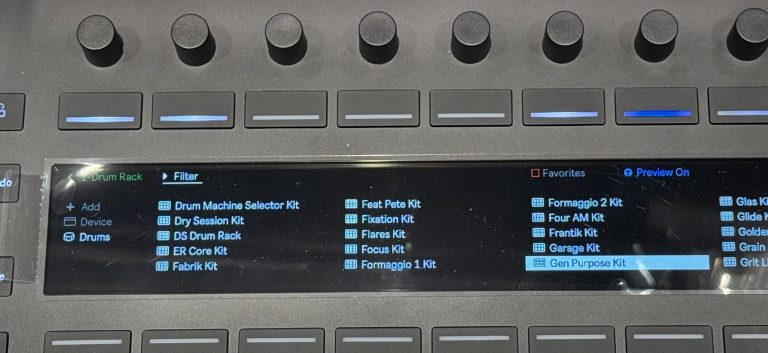
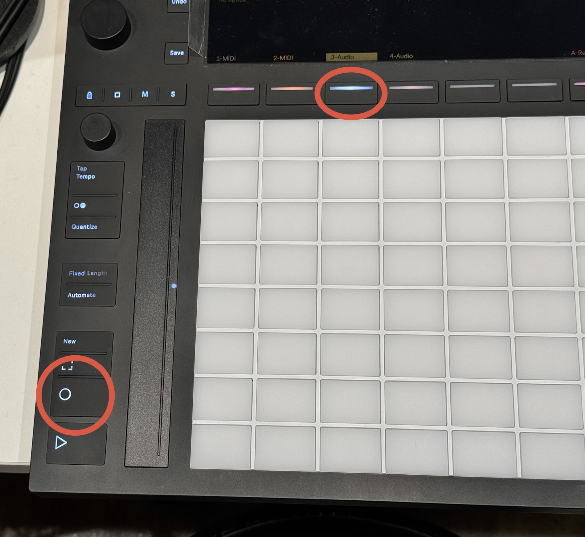

#### 【Ableton Push 3 で PCなしでビートメイク #3】エレキギターを録音してみましょう！
---
##### 新しいライブセットを作る

  何も入っていない空(から)の「曲」 "セット"を作成します。

  
  

    ①ページのマーク（紙がめくれてる感じのマーク）を押します。 
  

  
  

    ② 画面に New Set ボタンが出てくるので、New Set の下のボタンを押します。 
  

  
  

    ③ 既に開いているセットがあると保存するかを聞かれるので 保存しない場合は Don’t Save を選択します。 
  

  → MIDIトラック 2つとAudioトラック 2つのセットが作られます。

---
##### チューナーとギターアンプシミュレーターをインサートする

  

    
  

  

    画面の「3-Audio」の下のボタンを押して、"「3-Audio」トラック"を選択します。
  

  

プラスボタンを押して、Device > Audio Effects > Tuner を選択します。
<figure>

<figcaption>Device</figcaption>
</figure>
<figure>

<figcaption>Device > Drums</figcaption>
</figure>
<figure>

<figcaption>Device > Drums > Gen Purpose Kit</figcaption>
</figure>
---
同様の操作で Ampデバイス と Cabinetデバイス を追加していきます。

プラスボタンを押して、Device > Audio Effects > Amp を選択します。

プラスボタンを押して、Device > Audio Effects > Cabinet を選択します。
---
### アンプの音を作ってみましょう！

追加した Amp デバイスを選択します。

Amp は、実際のギターアンプの音色を再現するエフェクトです。

まずは Amp の種類を「Clean」に設定してみましょう。

Gain を上げると、音が歪んでいきます。

Bass、Middle、Treble を調整すると、音の低域・中域・高域を変えることができます。

---
### Cabinet を設定しましょう！

Cabinet は、ギターアンプのスピーカー部分を再現するエフェクトです。

Amp と Cabinet を組み合わせることで、実際のギターアンプに近い音を作ることができます。

まずは初期設定のまま使ってみましょう！

---
### ギターを接続しましょう！

Push 3 の背面にある入力端子にエレキギターを接続します。

今回は In 1 に接続してみましょう。

ギターは標準フォーンケーブル（シールド）で接続します。
---
ギター接続のための設定をする

Push 3の左上の歯車マークを押して、設定画面に入ります。

画面下側のAudioのボタンを押して、Audioのタブに入ります。

左から3列目の項目を左から3つ目のつまみを回して、「Inst.」に設定します。
※ ギターを直接接続する場合は、入力を Inst.（楽器用）に設定します。

左から4つ目のつまみを回すことで音量調整が出来ます。
演奏するときの強さでギターを弾いて、メーターにピークが付かないように設定します。

もう一度、Push 3の左上の歯車マークを押して 設定画面を抜けます。
---
### ギターの入力を設定しましょう！

画面の下の左から3番目のボタンを押して、「3-Audio」トラックを選択します。

Push 3の左下の録音ボタンを押しながら、トラック選択のボタン(画面の下の左から3番目のボタン)を押します。

ギターの音が聞こえるようになります！

---
### ギターをチューニングしましょう！
Push 3の右上の 丸が欠けたマークのボタン を押してデバイスの一覧を表示して、
画面左上の Tunerの文字の上のボタンを押します。

画面がチューナーになるので、チューニングしましょう！

---
### ギターを録音してみましょう！
縦に三本線のマークのボタンを押して、セッションビューにします。

「3-Audio」トラックに並んでいるセルのどれかを押すと録音が始まります。

クリックは丸が2つ並んだボタンでオン/オフが出来ます。

録音する長さは、「Fixed Length」ボタンを長押しすると、
画面下部のボタンで小節の長さを設定できます。
（ 「Fixed Length」  ボタンを何度か押して  Fixed Length: On にしてください ）

---
### まとめ

今回は Push 3 を使って、エレキギターを録音してみました！

- Tuner でギターをチューニング
- Amp,  Cabinet デバイスでアンプの音色を再現
- Audio トラックにギターを録音

Push 3 Standalone なら、パソコンを使わずにギターの録音からビート制作まで楽しめます！

ぜひ、自分だけのビートを作ってみてください！
